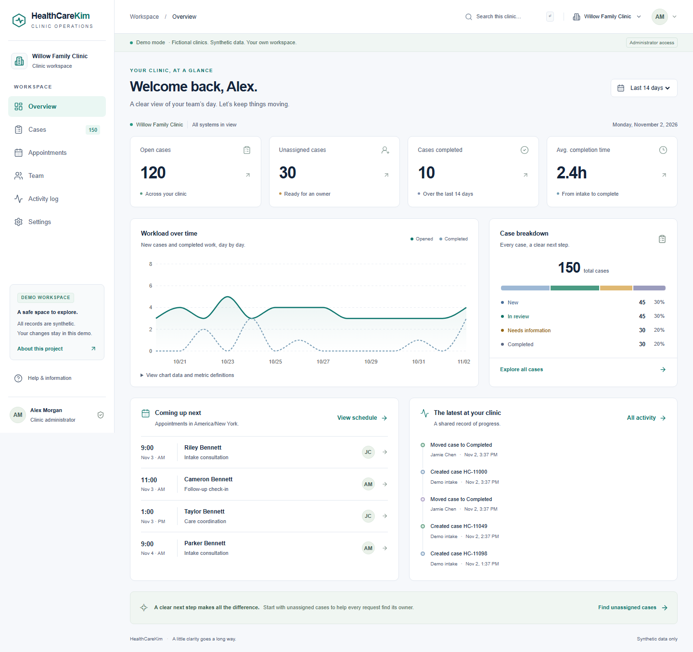
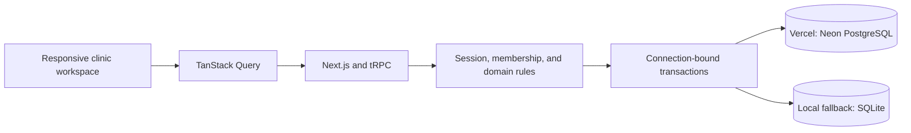

# HealthCareKim

**A clinic operations workspace connecting case triage, team assignments, appointments, and activity history across multiple clinics.**

HealthCareKim is a full-stack portfolio project with an English interface, persistent SQL records, and an isolated demo workspace for each visitor. Changes to cases and appointments are stored in Neon PostgreSQL and remain available after refreshing the deployed application.

All clinics, people, and operational records are fictional. This is a synthetic-data engineering demonstration, not clinical software, and is not affiliated with Bask Health.

| Quick links       | URL                                                                                      |
| ----------------- | ---------------------------------------------------------------------------------------- |
| Live website      | **[Open HealthCareKim](https://health-care-kim.vercel.app/)**                            |
| Start a demo      | [Choose a role and clinic](https://health-care-kim.vercel.app/demo) · No signup required |
| About the project | [About HealthCareKim](https://health-care-kim.vercel.app/about)                          |
| GitHub            | [dongyunkim96/HealthCareKim](https://github.com/dongyunkim96/HealthCareKim)              |



## Contents

- [Project overview](#project-overview)
- [Features](#features)
- [Demo access and roles](#demo-access-and-roles)
- [User guide](#user-guide)
- [Technology and architecture](#technology-and-architecture)
- [Local development](#local-development)
- [GitHub and Vercel deployment](#github-and-vercel-deployment)
- [Testing and verification](#testing-and-verification)
- [Development skills and tools](#development-skills-and-tools)
- [Scope and limitations](#scope-and-limitations)
- [Related documentation](#related-documentation)

## Project overview

The application gives clinic administrators and care coordinators a shared view of operational work. Visitors can triage cases, assign ownership, manage appointment availability, and inspect the history behind each change.

| Item             | Details                                                                  |
| ---------------- | ------------------------------------------------------------------------ |
| Demo clinics     | Willow Family Clinic, Harbor Wellness, and Summit Virtual Care           |
| Starting data    | 150 synthetic cases per clinic; 450 cases in each new workspace          |
| Perspectives     | Clinic administrator, care coordinator, and workspace viewer             |
| Clinic timezones | New York, Chicago, and Los Angeles                                       |
| Demo lifecycle   | Isolated workspaces expire after 24 hours; maximum 100 active workspaces |
| Hosting          | Vercel · Node.js 24.x · GitHub `main` branch                             |
| Hosted database  | Neon PostgreSQL · Free plan · AWS us-east-1                              |
| Local database   | SQLite through `better-sqlite3` when `DATABASE_URL` is empty             |

Demo workspaces are separate from one another. Reset replaces only the current visitor's workspace. Multiple tabs in one browser profile share the same session; use a separate profile or private window to explore independent workspaces.

## Features

| Area                    | Implementation                                                                                               |
| ----------------------- | ------------------------------------------------------------------------------------------------------------ |
| Overview                | Workload metrics, case-status distribution, completion trends, and recent activity                           |
| Case discovery          | Search, status/priority/assignee/type/date filters, sorting, and pagination                                  |
| Navigation state        | Filters and sorting in the URL, named saved views, and selection limited to the current result page          |
| Case workspace          | Desktop detail sheet, full-page detail, assignment, status and priority changes, and internal notes          |
| Case lifecycle          | Server-enforced transitions, completion timestamps, and a required reason when reopening a completed case    |
| Bulk operations         | Per-case results so valid changes can succeed while individual failures are explained                        |
| Edit conflicts          | Expected-version checks, preserved drafts, record refresh, and explicit retry                                |
| Appointments            | Create, reschedule, cancel, clinic-local business hours, and overlapping-booking prevention                  |
| Conflict recovery       | Clear booking errors, alternative appointment times, and preserved form input                                |
| Team and permissions    | Server-checked administrator, coordinator, and viewer roles; last-administrator protection                   |
| Clinic isolation        | Membership checks, clinic-scoped queries, and composite foreign keys                                         |
| Preferences             | Persisted appearance, density, visible columns, and personal views; clinic-level settings for administrators |
| Responsive access       | Sidebar, tablet rail, mobile drawer and cards, keyboard dialogs, and agenda layouts                          |
| Persistence and history | Transactional mutations, internal notes, and audit events stored in SQL                                      |

### Case and booking rules

- New → In review; In review → Needs information or Completed; Needs information → In review.
- Completed cases can return to In review with a reopen reason of at least five characters.
- Case changes, notes, and their audit events commit together. A stale version produces a conflict instead of overwriting another writer's changes.
- Active appointments for the same clinic and staff member cannot overlap. Back-to-back appointments are allowed, and cancellation releases the slot.
- Appointment input uses the clinic's timezone; storage uses UTC epoch milliseconds. Invalid daylight-saving times and bookings outside configured business hours are rejected.
- Roles and tenant boundaries are checked on the server for direct API calls as well as UI actions.

## Demo access and roles

Open [Start a demo](https://health-care-kim.vercel.app/demo), select a perspective and starting clinic, then click **Enter my workspace**. No email, password, invitation code, or API key is needed to try the website.

| Perspective          | Cases and appointments | Team and clinic settings                    | Personal views and preferences |
| -------------------- | ---------------------- | ------------------------------------------- | ------------------------------ |
| Clinic administrator | Read and write         | Manage                                      | Manage own                     |
| Care coordinator     | Read and write         | Read team; clinic administration restricted | Manage own                     |
| Workspace viewer     | Read only              | Read team; clinic administration restricted | Manage own                     |

The persona switcher selects only users already seeded in the current demo, rotates the session, and does not grant access to another workspace. It is a portfolio demonstration feature, not customer account registration.

## User guide

### Explore a complete case workflow

1. Enter as **Clinic administrator** at **Willow Family Clinic**.
2. Open **Cases**, select **Filters**, and filter by **New** and **Unassigned**.
3. Save the filter as a named view, such as **Intake triage**.
4. Open a case. On desktop, use **Full page** to move from the detail sheet to its own route.
5. Assign **Jamie Chen**, change the status to **In review**, and enter a synthetic internal note.
6. Select **Save changes**, then open **Activity history** to inspect the assignment and status events.
7. Refresh to confirm that the assignment, status, and note persist.
8. Switch clinics to inspect its separate records, members, appointments, settings, and views.
9. Use the account menu to try another perspective or reset only your workspace.

### Explore appointments and conflicts

1. Open **Appointments** as an administrator or coordinator.
2. Create an appointment for a fictional patient and staff member within the clinic's business hours.
3. Try creating another appointment for the same staff member at an overlapping time.
4. Review the conflict, select an offered alternative, and save the preserved draft.
5. Reschedule or cancel an appointment. Enable **Show cancelled** to inspect cancelled records.

To explore stale edits, open the same case in two tabs, save a change in one, then submit the older form in the other. The draft remains available while you refresh the record and review your changes before retrying.

## Technology and architecture

| Layer                    | Technology                                                                          |
| ------------------------ | ----------------------------------------------------------------------------------- |
| UI and server framework  | Next.js 16 App Router, React 19                                                     |
| Language and runtime     | Strict TypeScript 5; Node.js 24.x in Vercel                                         |
| Styling and components   | Tailwind CSS 4, Radix primitives, customized shadcn-style composition, Lucide icons |
| Server data and tables   | TanStack Query, TanStack Table                                                      |
| API and input validation | tRPC 11, Zod 4                                                                      |
| Forms                    | React Hook Form and Zod                                                             |
| Charts and timezones     | Recharts, date-fns, date-fns-tz                                                     |
| Hosted database          | `@neondatabase/serverless` Pool over WebSockets with `ws`                           |
| Local database and SQL   | `better-sqlite3`; Drizzle compiles bound queries for PostgreSQL and SQLite          |
| Sessions                 | iron-session; encrypted/sealed HTTP-only cookies containing an opaque session ID    |
| Testing                  | Vitest, PGlite with `btree_gist`, Playwright, and axe-core                          |

Exact dependency versions are recorded in [package.json](package.json) and [package-lock.json](package-lock.json).



| Path                       | Responsibility                                                            |
| -------------------------- | ------------------------------------------------------------------------- |
| `src/app/`                 | Marketing, demo entry, workspace routes, and API handlers                 |
| `src/components/`          | Overview, cases, details, appointments, team, and settings screens        |
| `src/server/router.ts`     | Runtime-validated API procedures                                          |
| `src/lib/service.ts`       | Authorization, clinic scoping, case rules, appointments, and audit writes |
| `src/lib/auth.ts`          | Cookie sessions and server-side identity resolution                       |
| `src/lib/db.ts`            | Lazy database adapters, parameter compilation, pooling, and transactions  |
| `src/lib/demo-fixtures.ts` | Batched synthetic data, expiration, and workspace creation                |
| `migrations/`              | Executable PostgreSQL and SQLite schemas                                  |
| `scripts/`                 | Setup, migrations, seed, cleanup, and local verification helpers          |
| `tests/`                   | Domain, SQL-parameter, competing-writer, and browser tests                |

### Data and transaction boundaries

A demo session owns users and clinics. Each clinic owns patients, cases, notes, appointments, memberships, saved views, table preferences, and audit events. Composite foreign keys prevent cross-clinic relationships; resource lookups include clinic identity.

AsyncLocalStorage keeps each transaction on its acquired connection. PostgreSQL clinic-row locks and SQLite immediate transactions serialize relevant writes. PostgreSQL exclusion constraints and SQLite triggers provide database-level appointment overlap protection. Personal preferences and views are scoped to the authenticated user.

The SQL backend is authoritative. Browser storage does not act as the operational database. Development and production builds use Webpack because Turbopack was unstable in the original Windows workspace.

## Local development

Use **Node.js 24.x** to match the deployment. The package supports Node.js `>=20.19.0 <25`.

```sh
git clone https://github.com/dongyunkim96/HealthCareKim.git
cd HealthCareKim
npm ci
npm run setup
npm run dev
```

Open **[http://127.0.0.1:3000](http://127.0.0.1:3000)** and choose **Explore demo**.

`setup` creates an ignored `.env.local` with a random session secret and never overwrites an existing file. With no `DATABASE_URL`, SQLite initializes its schema automatically. Browser demo entry creates its own records; CLI seeding is optional.

### Environment variables

| Variable                | Purpose                                                    | Configuration                                                                    |
| ----------------------- | ---------------------------------------------------------- | -------------------------------------------------------------------------------- |
| `DATABASE_URL`          | Pooled Neon connection URL                                 | Required for Vercel; optional for local PostgreSQL                               |
| `DATABASE_URL_UNPOOLED` | Direct PostgreSQL connection for migrations                | Used by `db:migrate` when configured                                             |
| `SESSION_SECRET`        | Persistent random session secret of at least 32 characters | Generated by local setup; required in production                                 |
| `APP_ORIGIN`            | Exact application origin                                   | Local: `http://127.0.0.1:3000`; production: `https://health-care-kim.vercel.app` |
| `DATABASE_PATH`         | Local SQLite file                                          | Defaults to `./data/healthcarekim.sqlite`; unused with Neon                      |

Use [.env.example](.env.example) as a key reference. Keep real secrets in ignored local environment files or Vercel environment variables. Never prefix database URLs or session secrets with `NEXT_PUBLIC_`.

### PostgreSQL setup and maintenance

After configuring the connection variables:

```sh
npm run db:migrate
npm run db:seed
npm run db:cleanup
```

Standalone database scripts load `.env.local`. Migrations preserve existing records and use an advisory lock. The named seed fixture is preserved on repeated runs until expiration; it does not create a browser login. Cleanup removes expired demo workspaces. Browser entry also cleans expired workspaces.

Local SQLite records are not automatically uploaded to Neon. Keep the same session secret across restarts to retain access to unexpired sessions.

### Local production build

```sh
npm run build
npm start
```

The default port is 3000. If using a different port, update `APP_ORIGIN` to match. Production cookie sessions require a configured secret.

## GitHub and Vercel deployment

**The website is deployed and connected to Neon:** [health-care-kim.vercel.app](https://health-care-kim.vercel.app/).

| Setting           | Value                               |
| ----------------- | ----------------------------------- |
| Repository        | `dongyunkim96/HealthCareKim`        |
| Vercel project    | `health-care-kim`                   |
| Production branch | `main`                              |
| Root directory    | Repository root                     |
| Framework preset  | Next.js                             |
| Node.js           | 24.x                                |
| Build command     | `npm run build`                     |
| Output directory  | Next.js default; no manual override |
| Database          | Neon PostgreSQL Free, AWS us-east-1 |

Pushing to the connected GitHub `main` branch triggers a Vercel production deployment.

### Connection and initialization

1. Connect the Neon integration to the Vercel project. The current project already has `DATABASE_URL` and `DATABASE_URL_UNPOOLED` supplied by that integration.
2. Configure a production `SESSION_SECRET` as a Secret and `APP_ORIGIN` as the production URL.
3. Apply `npm run db:migrate` through authorized tooling before serving requests against a new database. `npm run db:seed` is optional for a named CLI fixture; browser visitors receive separate workspaces.
4. Push the code or redeploy so Vercel uses the new environment settings.
5. Verify demo entry, persisted edits, permissions, and appointment conflicts on the deployed URL.

The default build command **does not run migrations or seeding automatically**. The current Neon schema was initialized before deployment. A Neon management API key is not needed by the application.

The server refuses to use a local SQLite file on Vercel when `DATABASE_URL` is missing. Its Neon pool is capped at three connections per Node instance with a one-second idle timeout; the app does not send keep-alive queries. These bounds support a small demo but do not guarantee unlimited free usage.

Only production `SESSION_SECRET` and `APP_ORIGIN` were configured during this release. Configure preview-specific values and an isolated database or Neon branch before relying on preview workflows. Do not assume previews are verified or isolated merely because the integration supplies database variables.

### Deployment issues resolved

| Issue                                                     | Resolution                                                                      |
| --------------------------------------------------------- | ------------------------------------------------------------------------------- |
| Original deployment used the SQLite implementation        | Pushed the asynchronous Neon adapter and redeployed the connected GitHub branch |
| Required production session settings were missing         | Added a dedicated production session Secret and exact `APP_ORIGIN`              |
| Project runtime was set to Node.js 26                     | Selected Node.js 24.x to match the package's supported range                    |
| Vercel plugin denied environment-variable writes with 403 | Configured the variables through the authenticated Vercel dashboard             |

## Testing and verification

The following checks were executed on **November 2, 2026**. Results distinguish embedded PostgreSQL, hosted database transport, and the actual public deployment.

| Check                                      | Result                                                                          |
| ------------------------------------------ | ------------------------------------------------------------------------------- |
| SQLite domain and parameter tests          | 27 passed                                                                       |
| PostgreSQL engine and parameter tests      | 27 passed in PGlite with `btree_gist`                                           |
| Local production browser suite with PGlite | 14 passed in 47.6 seconds, before adding the competing-HTTP scenario            |
| Local production app using live Neon       | 6 scenarios passed                                                              |
| **Public Vercel + Neon browser workflows** | **6 passed in 27.6 seconds**                                                    |
| Competing HTTP case edits                  | One success, one HTTP 409; one version increment and one note                   |
| Competing HTTP appointment bookings        | One success and one HTTP 409                                                    |
| Type checking, lint, and production build  | Passed                                                                          |
| Responsive and accessibility checks        | 360/390/768/1024/1440 widths; representative light/dark/mobile axe scans passed |
| Deployment                                 | Vercel Linux build completed; production READY confirmed                        |
| Post-deployment error-log check            | No error/fatal entries returned for the checked deployment and time window      |

The six public browser workflows cover demo entry, filtering, saved views, assignment, status changes, audit history, refresh persistence, clinic isolation, role enforcement, persona switching, appointment creation/rescheduling/cancellation, stale-edit recovery, competing writes, and workspace reset isolation.

```sh
npm run typecheck
npm run lint
npm test
npm run test:postgres
npm run build
npx playwright install chromium
# Start the application on port 3001 in another terminal:
# PowerShell: $env:PORT='3001'; npm run dev
# POSIX: PORT=3001 npm run dev
npm run test:e2e
```

Set `TEST_BASE_URL` to target a different application origin. The browser suite requires a running server; it creates synthetic workspaces and changes records on that server. The default origin is `http://127.0.0.1:3001`. Backend fault-injection tests clear `DATABASE_URL` and use isolated local databases.

SQLite competing-writer tests use independent Node processes. PGlite tests use competing asynchronous requests in its embedded engine; the separate hosted HTTP tests exercise pooled Neon transactions over network connections. These are functional concurrency checks, not sustained-load measurements.

Screenshots are in [docs/screenshots](docs/screenshots/), with failure artifacts in ignored `test-results/` and `playwright-report/`. Production dependency audit reported zero known vulnerabilities at the recorded check; development-tool advisories remain documented in the verification report. Automated accessibility checks do not establish certification.

## Development skills and tools

These Codex workflow skills were used or consulted during database setup and deployment. They are not runtime dependencies and are not required to run the project.

| Skill                                                  | Use or reference scope                                                                              |
| ------------------------------------------------------ | --------------------------------------------------------------------------------------------------- |
| `neon-postgres:neon` and `neon-postgres:neon-postgres` | Neon setup, pooled/direct connections, migrations, and PostgreSQL guidance                          |
| `neon-postgres:neon-postgres-branches`                 | Branching and migration-isolation guidance                                                          |
| `vercel:vercel-storage` and `vercel:bootstrap`         | Database integration and setup order                                                                |
| `vercel:env-vars`                                      | Server-only variables and separate production session settings                                      |
| `vercel:vercel-cli` and `vercel:deployments-cicd`      | Deployment targeting, Git integration, build status, and logs                                       |
| `computer-use:computer-use`                            | Consulted during UI automation setup; deployment settings were completed through browser automation |

Supporting tools included Git, npm, Vercel and Neon integrations, browser automation, Playwright, Vitest, PGlite, axe-core, and Prettier. No paid database upgrade was requested.

## Scope and limitations

- All records are fictional. Do not enter real patient information.
- The project does not provide diagnosis, treatment, prescribing, payments, real patient uploads, clinical integrations, HIPAA certification, or security certification.
- Demo personas are intentionally selectable within each visitor's workspace. Customer signup, password recovery, sent invitations, external identity providers, and MFA are not implemented.
- Tenant authorization, origin checks, session cookies, expiration, workspace bounds, and database constraints are implemented. Distributed rate limiting and production-scale abuse controls remain outside this demo.
- Hosting and database free tiers have provider quotas; demo expiration and connection limits do not remove them.
- Browser verification used Chromium. Physical devices, Safari/Firefox, full assistive-technology testing, sustained load, and multi-instance stress testing were not performed.
- Docker configuration is provided but was not built or verified in this environment.
- Historical local performance measurements in the verification report are not Vercel or Neon latency measurements.

## Related documentation

| Document                                                | Contents                                                                          |
| ------------------------------------------------------- | --------------------------------------------------------------------------------- |
| [Verification report](docs/verification.md)             | Executed checks, local/hosted test boundaries, and historical measurements        |
| [Engineering decisions](docs/engineering-decisions.md)  | Tenant isolation, transactions, UI state, scheduling, and tradeoffs               |
| [Neon setup](docs/neon-setup.md)                        | Database initialization, connection variables, free-plan behavior, and validation |
| [Screenshots](docs/screenshots/)                        | Desktop, tablet, mobile, case detail, scheduling, and conflict states             |
| [Environment template](.env.example)                    | Environment keys without credentials                                              |
| [Dependency and source notices](THIRD_PARTY_NOTICES.md) | Third-party license notices                                                       |
